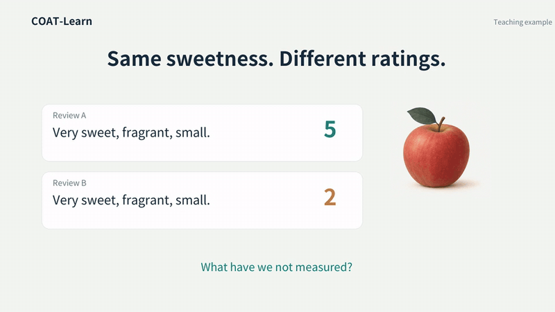

<!-- Generated from COAT-Learn/docs; edit the source, then run build.py. -->

# Understand COAT

You may have outcome records without knowing which other variables to measure. A rating is a number, while a review is free-form content. Analyzing only ratings leaves out the product attributes described in reviews. Asking a language model to explain reviews alone does not check its judgments against statistical relationships in the sample. COAT connects these two parts.

## Why discover variables first

Statistical analysis commonly starts with a variable table: one observation per row and one defined attribute per column. Unstructured data has no prepared attribute columns. Text and images contain information, but someone must still decide which information should become a variable.

A **factor** in COAT is a high-level attribute defined and measured from this material. For example, “sweetness described in the review” can have three levels. A definition specifies the meaning and assignment rules; annotation applies those rules to each review; the resulting values form a column for statistical computation. Factors can also support summaries, filtering or prediction without causal analysis.

**Factor discovery** addresses not yet knowing which attributes to measure. A language model reads selected examples and proposes candidate definitions. An annotation model measures them. Statistical methods select variables and construct feedback. The next round examines observations not sufficiently explained by existing variables and seeks missing information. Statistical analysis uses the measured factors to study their relationships.

### See the feedback loop

Similar measured attributes can accompany different ratings. Looking back at the original review reveals a bruising clue, motivating another measurement.

Preset teaching example. [Static illustration](/static/coat-journal/media/loop-poster-en.webp) · [Full introduction](/#intro-video ":ignore")

The paper considers text, images and data whose measurement requires external tools. This package provides ready-to-use text-column interfaces and statistical operations on measured tables.

## What a Markov blanket answers

A **Markov blanket** is an information-sufficient set around a target: given that set, the remaining variables provide no additional information about the target. The paper describes a minimal set satisfying this condition. In a causal directed acyclic graph under the relevant conditions, it contains the target's direct causes, direct effects and the other direct causes of those effects.

For example, sweetness and aroma may provide information about a rating. COAT-MB seeks and measures candidate attributes, then uses **conditional-independence tests** to ask whether a candidate remains related to the rating after considering existing variables. It updates the selected set iteratively and keeps a candidate pool for later screening.

The set is useful for later prediction and investigation, but is not a list of attributes whose improvement would raise the rating. Effects of the target can also belong to its blanket. Distinguishing directions requires further causal-structure analysis.

## Why additional variables can refine a causal graph

A **causal graph** uses nodes for variables and edges for causal structure. With only two related variables, the data may not distinguish which affects the other or whether they share an unmeasured cause. A common cause affects both variables and can produce an association without a direct effect between them.

COAT-PAG starts with existing numeric variables and seeks additional factors in their paired unstructured material. New variables supply more conditional-independence relationships that can refine adjacencies and edge marks among the initial variables. The goal is more than drawing extra nodes, and users do not need to supply an initial graph.

A **partial ancestral graph** (PAG) represents a class of candidate causal structures with the same conditional-independence relationships. Determined endpoint marks agree across that class; circle marks remain unresolved. FCI is the statistical causal-discovery algorithm used here to learn PAGs, allowing unobserved common causes.

Do not read every PAG arrow as a direct cause. An arrowhead expresses non-ancestry: under the structural assumptions, the node at the arrowhead is not an ancestor of the other endpoint. A circle does not mean a weak causal effect; it means unresolved structural information. See [result reference](<results.md#graph-endpoint-marks>) for the notation.

## Why effect estimation needs adjustment sets

A **treatment variable** represents the action being studied. An **outcome variable** represents the response after that action. The **average treatment effect** (ATE) compares the average outcome if everyone in the target population received treatment with the average if nobody did.

For example, frequent shoppers may also be more likely to receive marketing emails. Comparing visit rates between recipients and non-recipients would then mix existing customer differences with the email's effect. This shared influence is **confounding**.

A **valid adjustment set** is a group of variables that permits identification of the target effect by covariate adjustment under a specified graph, treatment, outcome and assumptions. Covariates are the other measured variables used in that adjustment. Selection must block non-causal paths without wrongly blocking the target effect or opening other paths. It is not a matter of controlling for every related variable.

COAT-ADJ discovers factors relevant to the effect analysis, refines the graph and searches for sets satisfying the generalized adjustment criterion. The package then uses **inverse probability weighting** (IPW): estimate each observation's probability of treatment and use it to weight the outcome comparison. Effect interpretation also depends on correct structure and measurements, an appropriate probability model, and a chance of both treatment and no treatment for each covariate profile, among other assumptions.

For a 0/1 visit outcome, an ATE of 0.03 means treatment increases the average visit probability by three percentage points, not by 3% relative to its baseline. This illustrates the unit; it is not a result from running the supplied data.

## Where to start with existing factors or graphs

With attribute definitions already chosen, use [standalone annotation](<annotation.md>) to build a measurement table without a discovery loop. With an existing measurement table, [learn a graph or test conditional independence](<causality.md>) without asking a language model to assign values again.

An existing graph can come from saved COAT results, another discovery method or a structure proposed from domain knowledge. Holding it fixed lets you find adjustment sets and estimate effects conditional on that graph being correct. Fixed means this computation does not modify it, not that it has been established as true.

Start with [your first analysis](<quickstart.md>) for a complete review example. See [discovery](<discovery.md>) for interfaces and the [paper](https://www.jmlr.org/papers/v27/25-2137.html) for research definitions and theoretical conditions.
